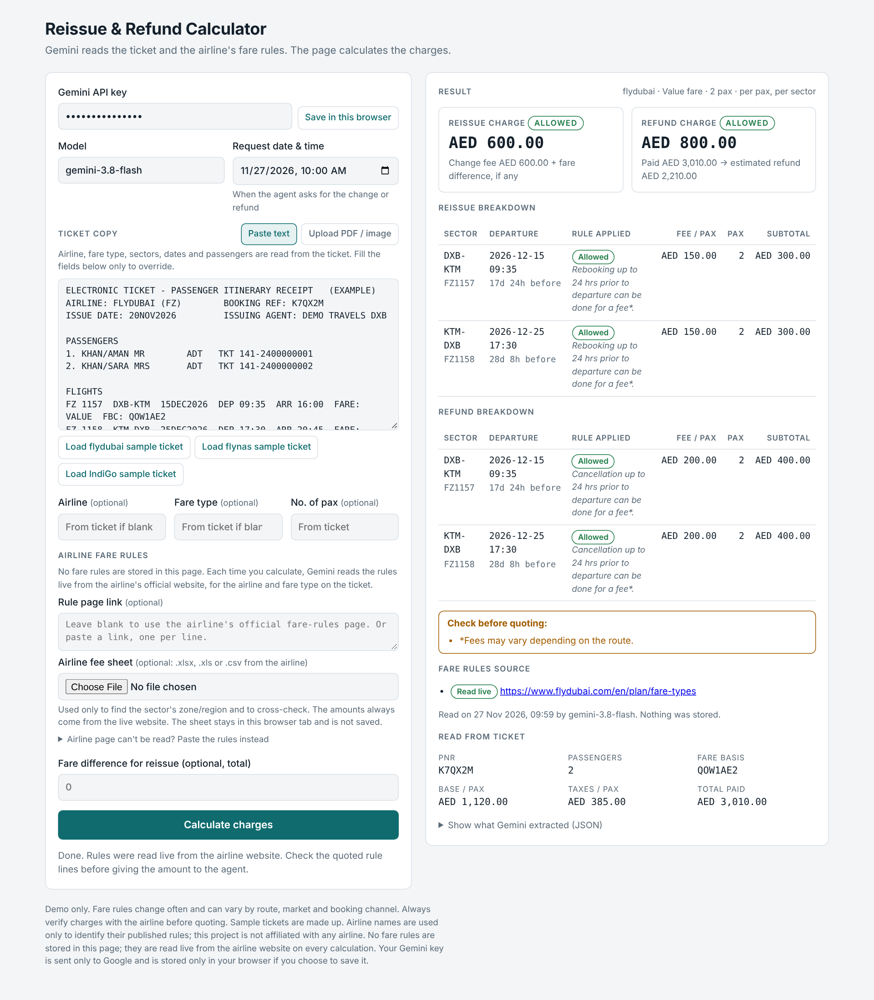
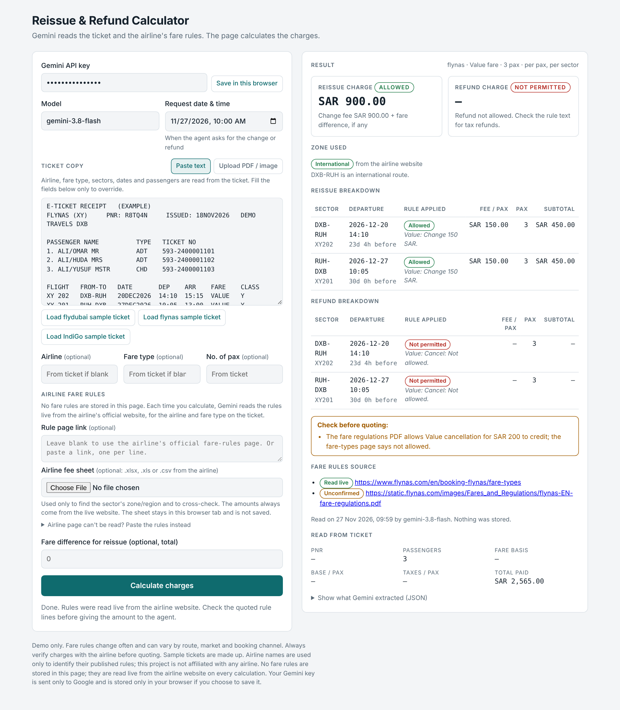
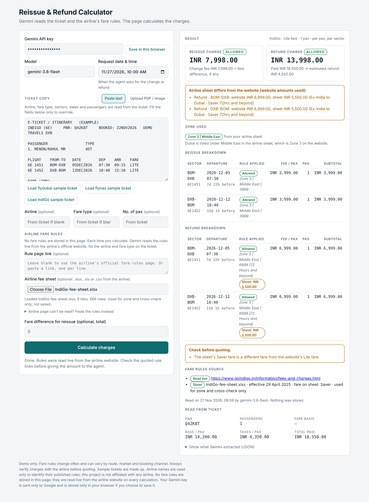

# Fare Rules AI: Reissue & Refund Calculator

An AI agent that reads a low-cost airline's fare rules **live from the airline's official website**, reads a ticket copy, and calculates the **reissue (change)** and **refund (cancellation)** charges for each sector, travel date and number of passengers.

**The AI reads, the code calculates.** Gemini turns the ticket and the airline's web page into structured data; plain JavaScript does the maths, so every amount is shown with the airline's own rule sentence behind it.



## The problem

Fare and ticketing teams keep LCC change and cancellation fees in spreadsheets and update them by hand every time an airline changes its rules, for every fare type and region. Every airline publishes its rules differently: one fee per fare type, city groups, country groups, numbered zones, sector-by-sector tables or "from" amounts. Quoting a charge means finding the right fare type, time window and route group, then multiplying by passengers and sectors. It is slow and easy to get wrong.

## How it works

```
Ticket copy ───────────► Gemini (ticket JSON) ─────┐
Airline website (live) ─► Gemini (rules JSON) ─────┤
Airline fee sheet (opt.) ─► zone + cross-check ────┤
                                                   └──► Calculator (plain JS) ──► Charges + rule lines + reasons
```

1. **Read the ticket:** airline, fare type, sectors, departure times, passengers, amounts paid.
2. **Read the rules live** from the airline's official page, including (i) tooltips, footnotes and PDFs. No fare rules are stored in the code, and no passenger data is sent with this step.
3. **Find the zone** where the airline uses zones, from the airline's own lists or fee sheet, with a reason.
4. **Calculate in code:** hours to departure → rule window → fee × passengers × sectors.
5. **Flag what needs a human:** "Check manually" with a plain reason, never a guessed amount.

Full details: [docs/how-it-works.md](docs/how-it-works.md)

## How to use

1. Get a free API key from [Google AI Studio](https://aistudio.google.com/).
2. Download the repository and open `index.html` in Chrome or Edge.
3. Paste your key, load a sample ticket (or paste your own), optionally add the airline's fee sheet, and click **Calculate charges**.

Step-by-step guide and troubleshooting: [docs/how-to-use.md](docs/how-to-use.md)

## Project structure

```
fare-rules-ai/
├── index.html              The page: inputs on the left, result on the right
├── css/
│   └── styles.css          Layout and colours (light and dark mode)
├── js/
│   ├── airlines.js         Official rule-page links per airline (links only, no rules)
│   ├── samples.js          Made-up sample tickets
│   ├── gemini.js           Prompts, live web reading, retry and model fallback
│   ├── sheet.js            Reads an optional airline fee sheet in the browser
│   ├── calculator.js       Charge calculation in plain code (no AI)
│   └── app.js              Page logic: Calculate flow and result display
├── samples/
│   └── tickets/            Sample ticket copies as text files
├── docs/
│   ├── how-it-works.md     Flow, prompts, zone mapping, calculation rules
│   ├── how-to-use.md       Setup, step by step, troubleshooting, adding an airline
│   ├── airlines.md         How each airline publishes its rules
│   └── screenshots/        Example results
├── LICENSE
└── README.md
```

## Samples

| Airline | Example | Result |
| --- | --- | --- |
| flydubai (FZ) | Value fare, DXB–KTM–DXB, 2 passengers | Reissue AED 600 + fare difference · Refund charge AED 800 |
| flynas (XY) | Value fare, DXB–RUH–DXB, 3 passengers | Reissue SAR 900 + fare difference · Refund not allowed |
| IndiGo (6E) | Lite fare, BOM–DXB–BOM, 1 passenger, with fee sheet | Zone 3 Middle East, from the airline sheet |

The screenshots in `docs/screenshots` were made with test replies standing in for Gemini; live results depend on the airline's page on the day.

<table><tr>
<td></td>
<td></td>
</tr></table>

## Airlines

Set up: flydubai, flynas, Air Arabia, IndiGo. Any other airline works by pasting its rule-page link, or by adding it to `js/airlines.js`. See [docs/airlines.md](docs/airlines.md) for how each airline publishes its rules and which can be added next.

## Privacy

- Your API key is sent only to Google, and saved in your own browser only if you choose.
- There is no backend. Nothing is stored on a server; an uploaded fee sheet stays in the browser tab.
- Sample tickets are made up. Do not use real passenger data in a demo.

## Roadmap

- More airlines: SalamAir, flyadeal, Air India Express, Akasa Air, SpiceJet, Fly Jinnah, Saudia, Air India, AirAsia, Scoot
- IndiGo: pick the table by fare type, direction and booking currency across all of IndiGo's fee pages
- Booking-date rules for airlines whose fees depend on when the ticket was bought
- Scheduled re-reading of airline pages, with alerts when a fee changes

## Disclaimer

Demo only. Fare rules change often and can vary by route, market, booking currency and channel. Always verify charges with the airline before quoting. Airline names are used only to identify their published rules; this project is not affiliated with any airline.

## Author

Built by **Aman Khan** as a personal project. MIT licensed.
