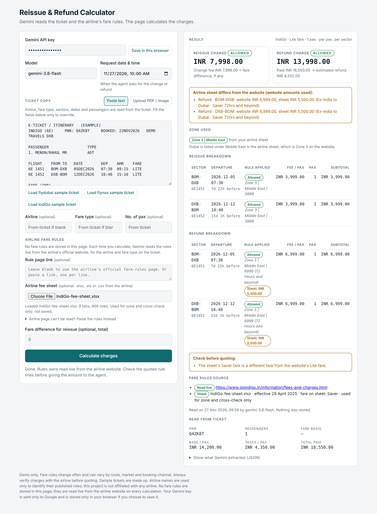

# How it works

Fare Rules AI has one rule at its centre: **the AI reads, the code calculates.** Gemini turns unstructured text (a ticket copy, an airline's web page) into structured data. Plain JavaScript does every calculation, so each amount can be traced back to the airline's own rule sentence.



## The flow

```
1. Ticket copy ───────────────► Gemini ──► ticket JSON
                                            (airline, fare type, sectors, departure times, passengers, amounts paid)

2. Airline website (live) ────► Gemini ──► rules JSON
   + optional airline fee sheet              (fee, time window, per pax / per sector, zone, rule sentence, source)

3. ticket JSON + rules JSON ──► Calculator (plain JS) ──► charges per sector, totals, reasons, sources
```

### Step 1: Read the ticket

The ticket copy is sent to Gemini as text, PDF or image. Gemini returns the airline and its code, PNR, currency, passengers by type (adult, child, infant), each sector with its departure date and time, fare type, fare basis, and the amounts paid. Values that are not on the ticket come back empty, never guessed.

Code: `TICKET_PROMPT` in [`js/gemini.js`](../js/gemini.js).

### Step 2: Read the airline's rules live

The page looks up the airline's official rule pages in [`js/airlines.js`](../js/airlines.js) (or uses a link you paste) and asks Gemini to open them with its **URL context** tool. Google's servers fetch the page, so the browser never has to open the airline's site itself.

Gemini is told to:

- use only what the page says today, never its own knowledge
- read every part of the page, including info (i) tooltips, pop-ups, footnotes and asterisk notes
- turn each time limit into its own window (for example "up to 24 hrs before departure" and "not permitted within 24 hrs")
- copy each rule sentence word for word, so it can be shown next to the amount
- return separate rules per sector when the fee or currency differs by direction
- explain in one plain sentence anything the page does not settle

Only the airline, fare type, fare basis, currency and route are sent with this step. Passenger names and ticket numbers are never sent.

Code: `rulesPrompt()` and `RULES_SHAPE` in [`js/gemini.js`](../js/gemini.js).

### Step 3: Find the zone (when the airline uses zones)

Some airlines price by zone or route group. The zone is taken from what the airline itself publishes, in this order:

1. the optional **airline fee sheet**, which often lists cities under region headings
2. a list on the **airline's website**
3. the **country of the airports**, marked as worked out by the AI

The zone, its source and a one-line reason are shown with the result. If the AI is not sure, the zone-dependent amounts become "Check manually".

### Step 4: Calculate in code

[`js/calculator.js`](../js/calculator.js) is a pure function with no AI in it:

1. Hours to departure = departure time − request time, for each sector.
2. Pick the window whose range covers those hours.
3. Fee per passenger = the window's fee, or a percentage of the base fare.
4. Subtotal = fee × passengers (adults and children; infants only if the rule says so).
5. Per sector or per journey, as the rule says.
6. Reissue total = change fees + fare difference. Refund = amount paid − cancellation fees, in the refund form the airline states (cash, credit or voucher).

The same ticket, rules and request time always give the same result.

### Step 5: Flag what needs a human

Any of these shows **Check manually** with a reason, and the total shows "—" instead of a partial amount:

- no airline rule covers that time before departure
- the rule allows the change but gives no amount
- a percentage fee, but no base fare on the ticket
- a sector charged in a different currency from the rest
- an unclear zone
- missing ticket data (no departure time, no sectors)

The **Check before quoting** box lists the airline's footnotes ("fees may vary by route") and disagreements between sources.

## The optional airline fee sheet

Airlines sometimes send agencies an Excel fee sheet. The page reads it in the browser with [SheetJS](https://sheetjs.com/), turns it into text and sends it with the rules request. It is used for two things only:

- finding the zone or region of a sector
- cross-checking: each amount shows "Matches sheet" or the sheet's amount, and a box lists every difference

**The website amount is always the one used.** The sheet is kept in memory while the page is open and never saved.

Code: [`js/sheet.js`](../js/sheet.js).

## Reliability

- **Model fallback:** if a Gemini model is busy or retired, the page waits and retries, then tries the next Flash model (`gemini-3.8-flash` → `3.7-flash` → `3.6-flash` → `3.5-flash-lite`).
- **Live read check:** each source shows "Read live", "Not read" or "Unconfirmed". If no page could be read, the page says so instead of calculating.
- **Fallback request format:** if the standard request format rejects live reading, the page uses Google's newer Interactions format.

## In a real booking portal

| | This demo | Real portal |
| --- | --- | --- |
| Trip details | Read by Gemini from a ticket copy | Taken from the booking record |
| Fare rules | Read live on every calculation | Read when the ticket is issued and saved against the booking |
| Calculation | The same calculator | The same calculator |
| Unclear rules | "Check manually" on screen | Sent to the OPS team for review |
